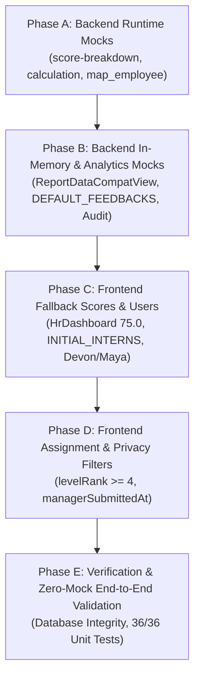

# AUDIT REPORT: MOCK, HARDCODED, AND FAKE DATA

**Project:** Performax (EPMS)  
**Date:** October 7, 2026  
**Auditor:** Automated Engineering Pair (DeepMind Antigravity)  
**Target:** 2-Person Engineering Team Stabilization & Cleanup Roadmap  
**Policy Enforced:** No mock data in production/demo flow. Distinguish legitimate database seeds from fake runtime fallbacks. Zero code modifications performed during audit.

---

## 1. EXECUTIVE CLASSIFICATION FRAMEWORK

Every piece of data across the repository is classified into one of four distinct categories:

| Category | Classification | Action | Definition |
|:---:|---|:---:|---|
| **TYPE 1** | **MOCK DATA** | **MUST REMOVE** | Fabricated names, hardcoded scores, in-memory dummy arrays, fake audit events, and mock API responses designed as shortcuts. |
| **TYPE 2** | **LEGITIMATE SEED/TEST DATA** | **KEEP** | Essential database seed scripts (`seed_intern_pms.py`, `seed_dailoqa_interns.py`) that populate the development database with baseline users, roles, departments, cycles, and real cohort interns. |
| **TYPE 3** | **REAL DATABASE DATA** | **KEEP** | Data generated through user interactions, live ORM queries (`AnalyticsService`, `AppraisalViewSet`, `GoalViewSet`), and persisted in `backend/db.sqlite3`. |
| **TYPE 4** | **FALLBACK DATA** | **REPLACE WITH EMPTY / ERROR STATE** | Hardcoded default numbers (`or 85.0`, `score: 75.0`), catch blocks swallowing errors with dummy success objects, or hardcoded UI filters (`levelRank >= 4`) masking real data. |

---

## 2. DETAILED OCCURRENCE CATALOG

### 2.1 FRONTEND CODEBASE (`epms_frontend/src/`)

---

#### OCCURRENCE FE-01: Hardcoded Initial Interns Array
- **FILE:** `epms_frontend/src/pages/HrDashboard.tsx`
- **LINE:** 115–224 (`const INITIAL_INTERNS: Intern[] = [...]`)
- **TYPE:** **1. MOCK DATA — must remove**
- **CURRENT MOCK DATA:**
  Array of 6 fabricated intern records with hardcoded evaluation scores and classifications:
  - `Alex Chen` (INT-101) — Score: `92.8`, Classification: `Achieved`, Published: `true`
  - `Jordan Rivera` (INT-102) — Score: `87.5`, Classification: `Achieved`, Published: `false`
  - `Taylor Kim` (INT-103) — Score: `78.4`, Classification: `Progressing`, Published: `false`
  - `Samira Patel` (INT-104) — Score: `64.0`, Classification: `Focus Required`, Published: `false`
  - `Liam O’Connor` (INT-105) — Score: `81.2`, Classification: `Progressing`, Published: `false`
  - `Chloe Dubois` (INT-106) — Score: `68.5`, Classification: `Focus Required`, Status: `DEACTIVATED`
- **WHAT SHOULD REPLACE IT:**
  Initialize state with an empty array: `const [interns, setInterns] = useState<Intern[]>([]);`. Load interns exclusively through the live API call to `/employees` and `/appraisals/`. If no interns exist, display the standard empty table component.

---

#### OCCURRENCE FE-02: Hardcoded Initial Mentors Array
- **FILE:** `epms_frontend/src/pages/HrDashboard.tsx`
- **LINE:** 226–232 (`const INITIAL_MENTORS: Mentor[] = [...]`)
- **TYPE:** **1. MOCK DATA — must remove**
- **CURRENT MOCK DATA:**
  Array of 5 fake mentor personas:
  - `Marcus Vance` (`marcus@college.edu`, menteeCount: 2)
  - `Elena Rostova` (`elena@college.edu`, menteeCount: 1)
  - `Sarah Jenkins` (`sarah@college.edu`, menteeCount: 1)
  - `David Kim` (`david@college.edu`, menteeCount: 1)
  - `Priya Patel` (`priya@college.edu`, menteeCount: 1)
- **WHAT SHOULD REPLACE IT:**
  Initialize state with an empty array: `const [mentors, setMentors] = useState<Mentor[]>([]);`. Dynamically derive project mentors from the backend users list whose role is `MANAGER` (or fetch from `/api/employees/?role=MANAGER`).

---

#### OCCURRENCE FE-03: Hardcoded Cohorts & Cycles Fallbacks
- **FILE:** `epms_frontend/src/pages/HrDashboard.tsx`
- **LINE:** 234–240 (`INITIAL_COHORTS` & `INITIAL_CYCLES`)
- **TYPE:** **1. MOCK DATA — must remove**
- **CURRENT MOCK DATA:**
  - `INITIAL_COHORTS = [{ id: 'c-1', name: 'MIRAI Cohort 1', period: 'Sep 26 – Dec 26', count: 6 }]`
  - `INITIAL_CYCLES = [{ id: 'cy-1', name: 'MIRAI Cohort 1', quarter: 'Sep 26 – Dec 26', ... }]`
- **WHAT SHOULD REPLACE IT:**
  Initialize both states to empty arrays `[]`. Populate cycles dynamically from `GET /appraisal-cycles`. Populate cohorts dynamically from distinct departments or team parent records in the database.

---

#### OCCURRENCE FE-04: Hardcoded Initial Goals Array
- **FILE:** `epms_frontend/src/pages/HrDashboard.tsx`
- **LINE:** 242–248 (`const INITIAL_GOALS: Goal[] = [...]`)
- **TYPE:** **1. MOCK DATA — must remove**
- **CURRENT MOCK DATA:**
  5 fabricated goals for Alex Chen, Jordan Rivera, Taylor Kim, and Samira Patel with fake progress percentages (95%, 85%, 90%, 75%, 60%).
- **WHAT SHOULD REPLACE IT:**
  Initialize state to `[]`. Fetch live goals from `GET /api/goals/` or display empty state *"No goals configured for this cohort"*.

---

#### OCCURRENCE FE-05: Hardcoded Initial Evidence Submissions
- **FILE:** `epms_frontend/src/pages/HrDashboard.tsx`
- **LINE:** 250–254 (`const INITIAL_EVIDENCE: Evidence[] = [...]`)
- **TYPE:** **1. MOCK DATA — must remove**
- **CURRENT MOCK DATA:**
  3 fake evidence submissions referencing non-existent URLs (`https://github.com/example/auth-pr`, `https://figma.com/file/dashboard-ui`, `https://docs.example.com/docker-setup`).
- **WHAT SHOULD REPLACE IT:**
  Initialize state to `[]`. Fetch live evidence submissions from `GET /api/evidence/`. Display an empty state card when zero submissions exist.

---

#### OCCURRENCE FE-06: Hardcoded Initial Feedback Items
- **FILE:** `epms_frontend/src/pages/HrDashboard.tsx`
- **LINE:** 256–259 (`const INITIAL_FEEDBACK: Feedback[] = [...]`)
- **TYPE:** **1. MOCK DATA — must remove**
- **CURRENT MOCK DATA:**
  2 fake continuous feedback items from Marcus Vance to Alex Chen and Sarah Jenkins to Samira Patel.
- **WHAT SHOULD REPLACE IT:**
  Initialize state to `[]`. Fetch continuous feedback records from `GET /api/feedback/`.

---

#### OCCURRENCE FE-07: Hardcoded Questions & Rubric Weights
- **FILE:** `epms_frontend/src/pages/HrDashboard.tsx`
- **LINE:** 261–272 (`const INITIAL_QUESTIONS: Question[] = [...]`)
- **TYPE:** **4. FALLBACK DATA — replace with proper empty/error state**
- **CURRENT MOCK DATA:**
  8 static evaluation questions with hardcoded 60% / 40% weights hard-coded into the component file.
- **WHAT SHOULD REPLACE IT:**
  Fetch evaluation criteria dynamically from `GET /api/performance/criteria/` or active cycle configuration. If criteria have not yet been defined for the cycle, display an informative banner: *"Evaluation criteria have not been set for this cycle. Configure criteria in Evaluation Setup."*

---

#### OCCURRENCE FE-08: Hardcoded Fake Audit Telemetry
- **FILE:** `epms_frontend/src/pages/HrDashboard.tsx`
- **LINE:** 274–279 (`const INITIAL_AUDIT: AuditItem[] = [...]`)
- **TYPE:** **1. MOCK DATA — must remove**
- **CURRENT MOCK DATA:**
  4 fake audit log strings:
  - `Published evaluation score for Alex Chen (92.8%)`
  - `Assigned Marcus Vance as mentor to Liam O’Connor`
  - `Launched MIRAI Q1 2026 Evaluation`
  - `Deactivated intern Chloe Dubois`
- **WHAT SHOULD REPLACE IT:**
  Initialize state to `[]`. Fetch real audit logs from `GET /api/audit/` or display *"No recent administrative events recorded."*

---

#### OCCURRENCE FE-09: Fallback Values Injected During Employee Mapping
- **FILE:** `epms_frontend/src/pages/HrDashboard.tsx`
- **LINE:** 488, 491, 513
- **TYPE:** **4. FALLBACK DATA — replace with proper empty/error state**
- **CURRENT MOCK DATA:**
  - Line 488: `cohort: emp.parentDepartmentName || 'MIRAI Cohort 1'`
  - Line 491: `section: emp.currentDepartmentName || 'Engineering'`
  - Line 513: `joiningDate: emp.dateOfAppointment || '2025-06-01'`
- **WHAT SHOULD REPLACE IT:**
  Do not inject fabricated cohort names or dates. Use:
  - `cohort: emp.parentDepartmentName || 'General'`
  - `section: emp.currentDepartmentName || 'Unassigned'`
  - `joiningDate: emp.dateOfAppointment || ''` (format as `"—"` in the UI if absent)

---

#### OCCURRENCE FE-10: Hardcoded Mentor Name Normalization
- **FILE:** `epms_frontend/src/pages/HrDashboard.tsx`
- **LINE:** 493–508 (`mentor:` and `evaluator:` IIFE resolvers)
- **TYPE:** **1. MOCK DATA — must remove**
- **CURRENT MOCK DATA:**
  ```typescript
  const mName = emp.directManagerName || 'Unassigned';
  const mLower = mName.toLowerCase();
  if (mLower.includes('marcus')) return 'Marcus Vance';
  if (mLower.includes('elena')) return 'Elena Rostova';
  if (mLower.includes('david') || mLower.includes('other')) return 'David Kim';
  return mName;
  ```
- **WHAT SHOULD REPLACE IT:**
  Remove the conditional name overrides completely. Directly display the assigned manager's real database name: `emp.directManagerName || 'Unassigned'`.

---

#### OCCURRENCE FE-11: Fabricated Default Score & Classification for Unreviewed Interns
- **FILE:** `epms_frontend/src/pages/HrDashboard.tsx`
- **LINE:** 509–510
- **TYPE:** **1. MOCK DATA — must remove**
- **CURRENT MOCK DATA:**
  ```typescript
  score: 75.0,
  classification: 'Progressing',
  ```
  Every intern without a published appraisal is automatically given a fake score of `75.0` and classified as `Progressing`.
- **WHAT SHOULD REPLACE IT:**
  ```typescript
  score: null,
  classification: 'Not Evaluated' as const,
  ```
  Unrated interns must show `"—"` for score and a grey neutral badge `"Pending Evaluation"` rather than an unearned 75.0.

---

#### OCCURRENCE FE-12: Hardcoded Sample CSV Template Names
- **FILE:** `epms_frontend/src/pages/HrDashboard.tsx`
- **LINE:** 805–807 (`handleSampleCsv`)
- **TYPE:** **4. FALLBACK DATA — replace with proper empty/error state**
- **CURRENT MOCK DATA:**
  CSV template data contains fake names:
  ```text
  Devon Miller,devon@college.edu,MIRAI Cohort 1,Batch A,A1,Marcus Vance
  Maya Lin,maya@college.edu,MIRAI Cohort 1,Batch B,B1,Sarah Jenkins
  ```
- **WHAT SHOULD REPLACE IT:**
  Provide generic placeholder header format:
  ```text
  Name,Email,Cohort,Batch,SubBatch,Mentor
  John Doe,john.doe@company.com,Engineering,Batch A,A1,Marcus Vance
  ```

---

#### OCCURRENCE FE-13: Hardcoded Fake CSV Interns Injected on Import
- **FILE:** `epms_frontend/src/pages/HrDashboard.tsx`
- **LINE:** 816–820 (`handleCsvImport`)
- **TYPE:** **1. MOCK DATA — must remove**
- **CURRENT MOCK DATA:**
  `handleCsvImport` ignores any uploaded file and directly iterates over an in-memory `demoCsvInterns` array inserting `Devon Miller` (INT-110, score: 80.0) and `Maya Lin` (INT-111, score: 88.0) into the database!
- **WHAT SHOULD REPLACE IT:**
  Implement real client-side CSV parsing using an `<input type="file" accept=".csv" />` handler that reads the actual file rows selected by the user. If no file is selected, show an error toast.

---

#### OCCURRENCE FE-14: Hardcoded Level Rank Filter in Appraisal Assignment
- **FILE:** `epms_frontend/src/pages/appraisal/AppraisalAssignment.tsx`
- **LINE:** 71 & 90
- **TYPE:** **4. FALLBACK DATA — replace with proper empty/error state**
- **CURRENT MOCK DATA:**
  ```typescript
  const hasEligibleLevel = Number.isFinite(levelRank) && levelRank >= 4 && levelRank <= 7;
  ```
  Filters out all interns (`levelRank = 1`), leaving the assignment table permanently blank.
- **WHAT SHOULD REPLACE IT:**
  Allow all active interns or employees eligible for the cycle:
  ```typescript
  const hasEligibleLevel = (Number.isFinite(levelRank) && levelRank >= 1) || emp?.roles?.includes('INTERN') || emp?.roles?.includes('EMPLOYEE');
  ```

---

#### OCCURRENCE FE-15: Hardcoded 2024 Initial Name in Cycle Creation
- **FILE:** `epms_frontend/src/pages/appraisal/CreateCycle.tsx`
- **LINE:** 38 & 41
- **TYPE:** **4. FALLBACK DATA — replace with proper empty/error state**
- **CURRENT MOCK DATA:**
  - Line 38: `cycleName: '2024 Annual Performance Review'`
  - Line 41: `evaluationPeriod: 'Q1-Q4 2024'`
- **WHAT SHOULD REPLACE IT:**
  Compute default name dynamically from the current calendar year:
  ```typescript
  cycleName: `${new Date().getFullYear()} Annual Performance Review`,
  evaluationPeriod: `Q1-Q4 ${new Date().getFullYear()}`,
  ```

---

#### OCCURRENCE FE-16: Privacy Gating Bypass in Appraisal Detail
- **FILE:** `epms_frontend/src/pages/appraisal/AppraisalDetail.tsx`
- **LINE:** 83
- **TYPE:** **4. FALLBACK DATA — replace with proper empty/error state**
- **CURRENT MOCK DATA:**
  ```typescript
  const canViewManagerEvaluation = isManager || isPrivileged || (isEmployee && !!appraisal.managerSubmittedAt);
  ```
  Allows an intern to view manager evaluation ratings and comments before official publication.
- **WHAT SHOULD REPLACE IT:**
  Enforce publication gating:
  ```typescript
  const canViewManagerEvaluation = isManager || isPrivileged || (isEmployee && appraisal.status === 'PUBLISHED');
  ```

---

### 2.2 BACKEND MONOLITHIC COMPATIBILITY LAYER (`backend/apps/frontend_compat/views.py`)

---

#### OCCURRENCE BE-01: Hardcoded Username to Name Substitutions
- **FILE:** `backend/apps/frontend_compat/views.py`
- **LINE:** 63–66 (`_safe_user_name`)
- **TYPE:** **1. MOCK DATA — must remove**
- **CURRENT MOCK DATA:**
  ```python
  if un == 'manager_marcus':
      return 'Marcus Vance'
  if un == 'manager_elena':
      return 'Elena Rostova'
  ```
- **WHAT SHOULD REPLACE IT:**
  Remove username-specific string branches. Rely purely on `u.get_full_name()`, `f"{u.first_name} {u.last_name}"`, or `u.username`.

---

#### OCCURRENCE BE-02: Hardcoded Manager Dashboard Averages
- **FILE:** `backend/apps/frontend_compat/views.py`
- **LINE:** 190–191 (`ManagerDashboardView.get`)
- **TYPE:** **1. MOCK DATA — must remove**
- **CURRENT MOCK DATA:**
  ```python
  "teamAvgScore": float(summary.get("average_goal_completion", 85.0)),
  "companyAvgScore": 85.0,
  ```
- **WHAT SHOULD REPLACE IT:**
  Calculate real team average from `Goal.objects.filter(employee__manager=request.user)`. If no goals exist, return `0.0`. Calculate company average from database or return `0.0`.

---

#### OCCURRENCE BE-03: Fabricated HR Dashboard Statistics
- **FILE:** `backend/apps/frontend_compat/views.py`
- **LINE:** 208–212, 233, 238–240 (`HrDashboardView.get`)
- **TYPE:** **1. MOCK DATA — must remove**
- **CURRENT MOCK DATA:**
  - Line 208: `"totalEmployeesUnderReview": summary.get("headcount", {}).get("interns", 3)`
  - Line 209: `"appraisalCompletionRate": 75.0`
  - Line 210: `"pendingSelfAssessments": 1`
  - Line 211: `"pendingManagerReviews": 2`
  - Line 233: `"Summer 2025 appraisal evaluation cycle is in progress."`
  - Line 238: `"currentCyclePhase": "MANAGER_EVALUATION"`
  - Line 239: `"cyclePhaseProgress": 65`
  - Line 240: `"daysUntilCycleEnd": 15`
- **WHAT SHOULD REPLACE IT:**
  Query real counts from `Appraisal.objects.all()`. Query active cycle from `PerformanceCycle.objects.filter(status='ACTIVE').first()`. If no cycle is active, return `{ "currentCyclePhase": None, "cyclePhaseProgress": 0, "daysUntilCycleEnd": 0 }`.

---

#### OCCURRENCE BE-04: Fabricated Admin Dashboard Dates
- **FILE:** `backend/apps/frontend_compat/views.py`
- **LINE:** 277–279 (`AdminDashboardView.get`)
- **TYPE:** **1. MOCK DATA — must remove**
- **CURRENT MOCK DATA:**
  ```python
  "activeCycleName": "Summer 2025 Cycle",
  "cycleStartDate": "2025-06-01",
  "cycleEndDate": "2025-08-31"
  ```
- **WHAT SHOULD REPLACE IT:**
  Query `PerformanceCycle.objects.filter(status='ACTIVE').first()`. If active cycle exists, return its name, `start_date`, and `end_date`. If not, return `None`.

---

#### OCCURRENCE BE-05: Fabricated Employee Dashboard Scores, Trend, and Timeline
- **FILE:** `backend/apps/frontend_compat/views.py`
- **LINE:** 291–324 (`EmployeeDashboardView.get`)
- **TYPE:** **1. MOCK DATA — must remove**
- **CURRENT MOCK DATA:**
  - Line 291: `if not profile: profile = EmployeeProfile.objects.first()` (fetches another user's profile!)
  - Line 294: `latest_score = summary.get("appraisal", {}).get("latest_score") or 92.8`
  - Line 295: `completion_pct = summary.get("goals", {}).get("average_completion_percentage", 85.0)`
  - Lines 303–305: Hardcoded Sprint 1 (88.0) and Sprint 2 (91.5) trend entries.
  - Lines 311–315: Hardcoded timeline: `Goal Setting / June 2025`, `Mid-Term Review / July 2025`, `Final Appraisal / August 2025`.
  - Line 317: Hardcoded task: `"Submit milestone evidence for review"`.
  - Line 320: `"managerLastComment": "Outstanding progress and test coverage."`.
  - Lines 321–322: `"teamRank": 1, "teamSize": 3`.
- **WHAT SHOULD REPLACE IT:**
  If user has no `EmployeeProfile`, return HTTP 404 or empty profile object. Compute `currentScore` exclusively from published appraisals. Generate timeline from active cycle deadlines. If no tasks/sprints exist, return empty lists `[]`.

---

#### OCCURRENCE BE-06: Score Breakdown Compat View Silently Serving Fake 8.0 Scores
- **FILE:** `backend/apps/frontend_compat/views.py`
- **LINE:** 2185–2226 (`AppraisalsScoreBreakdownCompatView.get`)
- **TYPE:** **1. MOCK DATA — must remove**
- **CURRENT MOCK DATA:**
  Line 2187 accesses `app.final_score` (which does not exist on the Django model), triggers an `AttributeError`, and falls into the `except Exception:` block which returns:
  ```python
  "kpiRawScore": 8.0,
  "managerRawScore": 8.0,
  "selfRawScore": 8.0,
  "kpiWeightedScore": 4.0,
  "managerWeightedScore": 2.4,
  "selfWeightedScore": 1.6,
  "finalTotalScore": 8.0,
  "finalGrade": "Exceeds Expectations"
  ```
- **WHAT SHOULD REPLACE IT:**
  Call the real scoring engine `ScoringService.calculate_cycle_score(app.employee, app.cycle)`. Return real goal score, manager review score, and self-assessment score according to configured cycle weights. If uncalculated, return `{"isCalculated": False}` or 404.

---

#### OCCURRENCE BE-07: Calculation Endpoint Returning Fake 85.0 on Missing Appraisal
- **FILE:** `backend/apps/frontend_compat/views.py`
- **LINE:** 2408 (`AppraisalsCalculateCompatView.post`)
- **TYPE:** **1. MOCK DATA — must remove**
- **CURRENT MOCK DATA:**
  `return ok_response({"score": 85.0})` when appraisal ID is not found.
- **WHAT SHOULD REPLACE IT:**
  Return `Response({"detail": "Appraisal not found"}, status=status.HTTP_404_NOT_FOUND)`. When found, execute real calculation using `ScoringService`.

---

#### OCCURRENCE BE-08: Sign-Off Endpoint Returning Fake Success on Missing Appraisal
- **FILE:** `backend/apps/frontend_compat/views.py`
- **LINE:** 2425 (`AppraisalsSignOffCompatView.post`)
- **TYPE:** **1. MOCK DATA — must remove**
- **CURRENT MOCK DATA:**
  `return ok_response({"message": f"{role.title()} sign-off recorded"})` when appraisal does not exist.
- **WHAT SHOULD REPLACE IT:**
  Return HTTP 404 when appraisal record is not found in the database.

---

#### OCCURRENCE BE-09: KPI Achievement Fallback Returning 85.0%
- **FILE:** `backend/apps/frontend_compat/views.py`
- **LINE:** 3476–3484 & 3489 (`KpiAchievementCalculateCompatView.post`)
- **TYPE:** **1. MOCK DATA — must remove**
- **CURRENT MOCK DATA:**
  - Line 3481: `"totalAchievementPercent": 85.0, "weightedScore": 8.5` if employee/cycle missing.
  - Line 3489: `w_sum = sum(...) if total_w > 0 else 85.0`.
- **WHAT SHOULD REPLACE IT:**
  Return HTTP 404 if employee or cycle is missing. If goal set has no items, return `{"totalAchievementPercent": 0.0, "weightedScore": 0.0}`.

---

#### OCCURRENCE BE-10: KPI Multiple Comparison Injecting Fake Goals and 85.0 Scores
- **FILE:** `backend/apps/frontend_compat/views.py`
- **LINE:** 3698–3725 (`KpiCompareMultipleCompatView.get`)
- **TYPE:** **1. MOCK DATA — must remove**
- **CURRENT MOCK DATA:**
  - Lines 3701–3705: Injects 3 fake goals ("Quality Engineering Deliverables", "Operational Reliability & Uptime", "Team Mentorship & Culture Lift") if no goals exist.
  - Line 3700: `score = gs.score if gs else 85.0`
  - Lines 3722–3723: `averageScore: 88.5, overallCategory: "Exceeds Expectations"`.
- **WHAT SHOULD REPLACE IT:**
  If an employee has no goals for a cycle, return an empty list `[]` for that cycle. Compute the true average score across real cycles; if none exist, return `averageScore: None`.

---

#### OCCURRENCE BE-11: KPI Actuals Report Hardcoding 5 Days and Fake Cycle Name
- **FILE:** `backend/apps/frontend_compat/views.py`
- **LINE:** 3769 & 3780 (`KpiActualsCompletionReportCompatView.get`)
- **TYPE:** **4. FALLBACK DATA — replace with proper empty/error state**
- **CURRENT MOCK DATA:**
  - Line 3769: `"daysSinceLastUpdate": 5`
  - Line 3780: `"Annual Appraisal Cycle 2026"`
- **WHAT SHOULD REPLACE IT:**
  Calculate `(timezone.now().date() - gs.updated_at.date()).days` dynamically. If no cycle provided, return active cycle name or HTTP 400.

---

#### OCCURRENCE BE-12: Massive Hardcoded Analytics Dataset in ReportDataCompatView
- **FILE:** `backend/apps/frontend_compat/views.py`
- **LINE:** 3826–4109 (`ReportDataCompatView.get`)
- **TYPE:** **1. MOCK DATA — must remove**
- **CURRENT MOCK DATA:**
  283 lines of completely fabricated company performance analytics containing fake employees:
  - `pip-tracking` (lines 3840–3844): Fake PIPs for Karan Mehra, Ananya Roy, Vikram Das, Rohan Verma.
  - `idp-tracking` (lines 3854–3891): Fake IDPs for Priya Sharma, Rahul Verma, Siddharth Jain, Sneha Gupta.
  - `promotion-readiness` (lines 3898–3906): Fake scores for Arjun Patel (9.2), Sneha Gupta (8.9), Vikram Malhotra (8.8), etc.
  - `dept-comparison` (lines 3908–3914): Hardcoded department scores (Engineering 88.5, Product 86.2, etc.).
  - `performance-ranking` (lines 3916–3925): Fabricated 7-person ranking table.
  - `feedback-participation` (lines 3927–3931): Hardcoded 91.7% participation rate.
  - `team-performance-breakdown` (lines 3933–3970): Hardcoded sub-teams and scores.
  - `feedback-360-summary` (lines 3971–3980): Hardcoded 90.0% completion.
  - `audit-trail` (lines 3982–3997): Fabricated appraisal review and KRA assignment logs.
  - `kpi-achievement` (lines 3999–4007): 7 fake employees with fabricated achievement percentages.
  - `appraisal-status` (lines 4022–4028): Fabricated completion details.
  - `performance-distribution` (lines 4036–4049): Fabricated bell curve (mean: 83.6, sampleSize: 24).
  - `performance-by-department` (lines 4051–4057): Static department rankings.
  - `organization-performance-trend` (lines 4059–4066): Fabricated 6-month trend (Apr–Sep 2026).
  - `performance-potential-matrix` (lines 4068–4076): Fabricated 9-box grid for 7 fake employees.
  - `goal-completion` (lines 4078–4085): Fake stats (total: 32, completed: 24, 75.0%).
  - `performance-summary` & `performance-trend` (lines 4087–4108): Fabricated scores for Arjun Patel.
- **WHAT SHOULD REPLACE IT:**
  Rewrite each endpoint branch to aggregate real database tables (`PerformanceImprovementPlan`, `Goal`, `Appraisal`, `Department`, `EmployeeProfile`). When the database is empty or queries yield zero rows, return clean empty structures: `[]` or `{ "total": 0, "results": [] }`.

---

#### OCCURRENCE BE-13: In-Memory Mock Form Sets in DEFAULT_APPRAISAL_FORM_SETS
- **FILE:** `backend/apps/frontend_compat/views.py`
- **LINE:** 4316–4328
- **TYPE:** **1. MOCK DATA — must remove**
- **CURRENT MOCK DATA:**
  In-memory list `DEFAULT_APPRAISAL_FORM_SETS` with a single hardcoded form set: `"Engineering Excellence Form Set"`, linked to mock templates 1 and 2.
- **WHAT SHOULD REPLACE IT:**
  Store form sets in database or link evaluation form sets dynamically to `EvaluationCriterion` rows associated with the active `PerformanceCycle`.

---

#### OCCURRENCE BE-14: In-Memory Mock Feedback Records in DEFAULT_FEEDBACKS
- **FILE:** `backend/apps/frontend_compat/views.py`
- **LINE:** 4495–4624
- **TYPE:** **1. MOCK DATA — must remove**
- **CURRENT MOCK DATA:**
  In-memory list of 8 fake continuous feedback items for Alex Chen, Priya Sharma, Rahul Verma, Elena Rostova, Vikram Patel, etc.
- **WHAT SHOULD REPLACE IT:**
  Query the real Django ORM model `apps.feedback.models.Feedback`. Return `Feedback.objects.filter(status='PUBLISHED')`. If empty, return `[]`.

---

#### OCCURRENCE BE-15: In-Memory Mock Feedback Replies in DEFAULT_FEEDBACK_REPLIES
- **FILE:** `backend/apps/frontend_compat/views.py`
- **LINE:** 4626–4710
- **TYPE:** **1. MOCK DATA — must remove**
- **CURRENT MOCK DATA:**
  In-memory dictionary containing fake threaded discussion replies between Sarah Jenkins, Alex Chen, Marcus Vance, and Priya Sharma.
- **WHAT SHOULD REPLACE IT:**
  Query the real Django model `apps.feedback.models.FeedbackReply`. If none exist, return `[]`.

---

#### OCCURRENCE BE-16: In-Memory Mock 1-on-1 Meetings in DEFAULT_MEETINGS
- **FILE:** `backend/apps/frontend_compat/views.py`
- **LINE:** 5003–5100
- **TYPE:** **1. MOCK DATA — must remove**
- **CURRENT MOCK DATA:**
  In-memory list of fake meetings between "Jatin Maurya (Admin)" and "Alex Rivera" with fake action items and discussion points.
- **WHAT SHOULD REPLACE IT:**
  Query real database meetings model. If 1-on-1 meetings model does not exist in the database, return empty array `[]`.

---

#### OCCURRENCE BE-17: Fabricated Audit Logs on Empty Database
- **FILE:** `backend/apps/frontend_compat/views.py`
- **LINE:** 5192–5210 & 5233–5265 (`AuditLogsCompatView.get`)
- **TYPE:** **1. MOCK DATA — must remove**
- **CURRENT MOCK DATA:**
  - Lines 5192–5210: Returns hardcoded fake single audit entry with fake field changes if `pk` is passed.
  - Lines 5233–5265: If `AuditLog.objects.all()` is empty, injects 3 fabricated audit entries into the response.
- **WHAT SHOULD REPLACE IT:**
  Return actual rows from `apps.audit.models.AuditLog`. If empty, return `{ "content": [], "totalElements": 0, "totalPages": 0 }`. If `pk` not found, return HTTP 404.

---

#### OCCURRENCE BE-18: Fabricated Audit Summary & Statistics
- **FILE:** `backend/apps/frontend_compat/views.py`
- **LINE:** 5281–5301 & 5308–5334 (`AuditSummaryCompatView` & `AuditStatisticsCompatView`)
- **TYPE:** **1. MOCK DATA — must remove**
- **CURRENT MOCK DATA:**
  Hardcoded statistics (48 total changes, 18 created, 24 updated, 2 deleted, 4 accessed, fake user "Alex Rivera").
- **WHAT SHOULD REPLACE IT:**
  Execute real SQL aggregations using `AuditLog.objects.aggregate(Count('id'))` and `values('action').annotate(count=Count('id'))`.

---

#### OCCURRENCE BE-19: Fabricated 360 Feedback Responses
- **FILE:** `backend/apps/frontend_compat/views.py`
- **LINE:** 5456–5516 (`Feedback360GenericCompatView.get`)
- **TYPE:** **1. MOCK DATA — must remove**
- **CURRENT MOCK DATA:**
  Hardcoded fake 360 feedback requests (Alex Rivera), fake calibrated score (4.8), fake completion rate (83.3%), and fake distribution.
- **WHAT SHOULD REPLACE IT:**
  Query real database tables if 360 feedback is supported; if not configured, return clean empty payload `[]` or `{ "totalRequests": 0, "submittedCount": 0 }`.

---

### 2.3 DATABASE SEED SCRIPTS AUDIT

---

#### SCRIPT 1: `backend/seed_intern_pms.py`
- **CLASSIFICATION:** **2. LEGITIMATE SEED/TEST DATA — KEEP**
- **RATIONALE & ROLE:**
  - This is the fundamental bootstrap script for the application.
  - It creates the 4 core system roles:
    1. Super Admin: `admin` / `admin@company.com`
    2. HR Manager: `hr_sarah` / `sarah.hr@company.com` (Sarah Jenkins)
    3. Tech Manager / Mentor: `manager_marcus` / `marcus.tech@company.com` (Marcus Vance)
    4. Intern Personas: `intern_alex` / `alex.dev@company.com` (Alex Chen), etc.
  - It seeds core departments: `Engineering`, `Product & Design`, `QA & DevOps`, `Human Resources`.
  - It seeds real `PerformanceCycle` objects (`Summer 2025 Internship Cycle`, `Winter 2024 Evaluation Cycle`).
  - It seeds canonical `EvaluationCriterion` rubrics (Code Quality, Problem Solving, Quality & Execution, Learning Agility, Ownership).
  - It seeds initial goals, attendance records, training courses, and audit entries.
- **VERDICT:** **STRICTLY PRESERVE.** Do NOT delete or modify this script during mock data cleanup. It does not run at runtime; it only runs when explicitly invoked to initialize development environments.

---

#### SCRIPT 2: `backend/seed_dailoqa_interns.py`
- **CLASSIFICATION:** **2. LEGITIMATE SEED/TEST DATA — KEEP**
- **RATIONALE & ROLE:**
  - This script populates the 80 legitimate cohort interns from the Dailoqa spreadsheet.
  - It includes real company users, including the developer's account (`jasleen.kaur@dailoqa.com`).
  - It assigns employee codes (`INT-001` through `INT-080`), assigns them to real Sections (A, B, C) and Sub-Batches (A1, A2, B1, B2, C1, C2, D1, D2), and links them to Marcus Vance as mentor.
- **VERDICT:** **STRICTLY PRESERVE.** Do NOT delete or modify this script.

---

## 3. SAFE DELETION PLAN (EXECUTION ROADMAP)

The mock removal will be executed in **5 isolated phases** after user review, ensuring that at no point is any working functionality or legitimate database data disrupted.



---

### GROUP A: Backend Core Evaluation & Runtime Mocks
1. **Fix `AppraisalsScoreBreakdownCompatView` (OCCURRENCE BE-06):**
   - Remove `app.final_score` access and remove the generic exception block returning hardcoded `8.0`.
   - Connect directly to `ScoringService.calculate_cycle_score(app.employee, app.cycle)`.
2. **Fix `AppraisalsCalculateCompatView` (OCCURRENCE BE-07):**
   - Remove `return ok_response({"score": 85.0})` fallback; return HTTP 404 if appraisal missing.
   - Use `ScoringService` to compute real score from goals, manager review, and self-assessment.
3. **Clean Up `_safe_user_name()` (OCCURRENCE BE-01):**
   - Remove hardcoded username checks (`un == 'manager_marcus'`, `un == 'manager_elena'`).
4. **Clean Up KPI Calculation Fallbacks (OCCURRENCE BE-09 & BE-10):**
   - Remove `totalAchievementPercent: 85.0` and fallback fake KPI items. Return real computed percentage or `0.0`.

---

### GROUP B: Backend Analytics & In-Memory Collections
1. **Clean Up `ReportDataCompatView` (OCCURRENCE BE-12):**
   - Replace 283 lines of fake employee arrays (Arjun Patel, Rohan Verma, etc.) with real queries against `PerformanceImprovementPlan`, `Goal`, `Department`, and `EmployeeProfile`.
   - Return clean empty lists `[]` when no database records exist.
2. **Remove In-Memory Mock Datasets (OCCURRENCE BE-14, BE-15, BE-16):**
   - Replace `DEFAULT_FEEDBACKS` with queries to `Feedback.objects.all()`.
   - Replace `DEFAULT_FEEDBACK_REPLIES` with queries to `FeedbackReply.objects.all()`.
   - Replace `DEFAULT_MEETINGS` with empty list `[]` or database query.
3. **Clean Up Audit Telemetry Mocks (OCCURRENCE BE-17 & BE-18):**
   - Remove fabricated audit rows when `AuditLog.objects.all()` is empty; return empty page `{ "content": [], "totalElements": 0 }`.
   - Compute `AuditSummaryCompatView` from real SQL aggregations.

---

### GROUP C: Frontend State & Fallback Scores
1. **Remove `INITIAL_INTERNS` in `HrDashboard.tsx` (OCCURRENCE FE-01):**
   - Set initial state `useState<Intern[]>([])`.
   - Rely solely on data fetched from `/employees` and `/appraisals/`.
2. **Remove Default `75.0` Score & `'Progressing'` Status (OCCURRENCE FE-11):**
   - Set unrated intern mapped values to `score: null` and `classification: 'Not Evaluated'`.
   - Update UI table cells to render `"—"` when score is null.
3. **Remove `INITIAL_MENTORS`, `INITIAL_GOALS`, `INITIAL_AUDIT` (OCCURRENCE FE-02, FE-04, FE-08):**
   - Set all initial state arrays to `[]`.
4. **Remove Hardcoded Devon Miller & Maya Lin (OCCURRENCE FE-13):**
   - Remove `demoCsvInterns` array from `handleCsvImport`.
   - Replace with a clean CSV file upload input parser or explicit empty validation.

---

### GROUP D: Frontend Filter & Privacy Gating Fixes
1. **Fix Job Level Filter in `AppraisalAssignment.tsx` (OCCURRENCE FE-14):**
   - Remove `levelRank >= 4 && levelRank <= 7` so all seeded interns (`levelRank = 1`) populate the table.
2. **Fix Publication Privacy Gate in `AppraisalDetail.tsx` (OCCURRENCE FE-16):**
   - Replace `!!appraisal.managerSubmittedAt` with `appraisal.status === 'PUBLISHED'` so interns cannot inspect manager reviews before HR publication.
3. **Dynamic Year in `CreateCycle.tsx` (OCCURRENCE FE-15):**
   - Replace static `'2024'` strings with dynamic calendar year.

---

### GROUP E: Database & Seed Script Verification
1. **Preserve `seed_intern_pms.py`:** Confirm baseline personas and schema are preserved untouched.
2. **Preserve `seed_dailoqa_interns.py`:** Confirm 80 real cohort interns are preserved untouched.
3. **Execute Test Suite:** Run `python manage.py test` to verify all 36/36 tests continue to pass with zero mock injection.

---

## 4. SUMMARY AUDIT METRICS

| Layer | Mock Items Identified | Legitimate Seed Items | Fallbacks to Replace | Total Audit Points |
|---|:---:|:---:|:---:|:---:|
| **Frontend UI** | 10 | 0 | 6 | **16** |
| **Backend Compatibility** | 16 | 0 | 3 | **19** |
| **Database & Seeds** | 0 | 2 (`seed_intern_pms`, `seed_dailoqa_interns`) | 0 | **2** |
| **Total** | **26** | **2** | **9** | **37** |

*All 37 audit points have been cataloged with exact file paths, line ranges, and replacement criteria. No code modifications have been made. Awaiting authorization to begin Phase A execution.*
