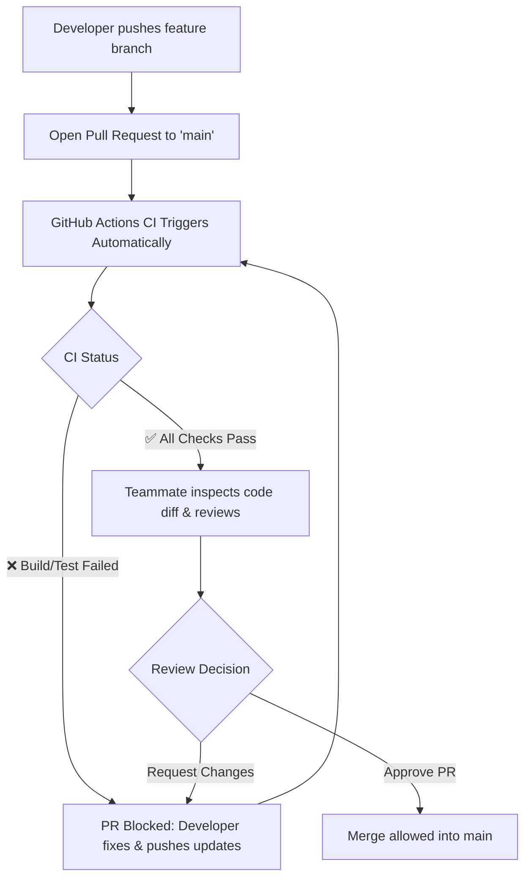

# 🚀 Performax Team Git & Collaboration Workflow

This document defines the team Git lifecycle, branching conventions, Docker workflows, and pull request verification rules for the **Performax (Intern Performance Management System)** project.

---

## 1. 👥 Team Core Principles

1. **`main` is protected:** No direct pushes to `main`. Every code change enters `main` only through a peer-reviewed Pull Request (PR) with passing CI tests.
2. **Zero Host Dependency Setup:** Teammates do not need to install Python, Node.js, or PostgreSQL on their machines. Everything is containerized with Docker.
3. **Automated Verification:** GitHub Actions CI builds and verifies every branch and pull request against real PostgreSQL and automated test suites.
4. **Mandatory Peer Review:** At least one teammate / Code Owner approval is required before merging.

---

## 2. 🐳 Zero-Setup Local Development (Docker)

To start the entire application (PostgreSQL + Django API + React Frontend) without installing local libraries:

```bash
# 1. Clone the repository
git clone https://github.com/JatinM007/Performax.git
cd Performax

# 2. Copy the environment template
cp .env.example .env

# 3. Start all containers (installs all libraries inside Docker automatically)
docker compose up --build
```

### Accessing Local Services
- **Web App (Frontend):** [http://localhost:5173](http://localhost:5173)
- **Backend API Docs (Swagger):** [http://localhost:8000/api/docs/](http://localhost:8000/api/docs/)
- **PostgreSQL Database:** `localhost:5432` (`intern_pms_db`)

### Stopping Containers
```bash
# Stop containers (preserves database data)
docker compose down

# Stop and remove all persistent data (clean slate)
docker compose down -v
```

---

## 3. 🌿 Branching Strategy

Always create a new branch from up-to-date `main`:

```bash
# Switch to main and pull latest changes
git switch main
git pull origin main

# Create a feature branch
git switch -c feature/intern-progress-tracker
```

### Branch Naming Conventions
- `feature/<short-name>`: New features (e.g., `feature/evidence-upload`, `feature/hr-analytics`)
- `fix/<bug-name>`: Bug fixes (e.g., `fix/kpi-weight-calculation`, `fix/login-session-expire`)
- `refactor/<name>`: Code cleanup or restructuring
- `test/<name>`: Adding or improving automated tests
- `docs/<name>`: Documentation updates

---

## 4. 📝 Commit Standards

Write clear, structured commit messages following Conventional Commits:

```bash
git add .
git commit -m "feat(intern): add evidence attachment modal to goal tracker"
```

| Type | When to use |
|---|---|
| `feat:` | A new feature or endpoint |
| `fix:` | A bug fix |
| `test:` | Adding or modifying tests |
| `refactor:` | Refactoring without changing behavior |
| `docs:` | Documentation changes only |
| `chore:` | Dependency updates, tooling, or Docker config |

---

## 5. 🔄 Pull Request & Peer Review Lifecycle



### Step 1: Push Branch and Open PR
```bash
git push -u origin feature/intern-progress-tracker
```
1. Go to the GitHub repository.
2. Click **Compare & pull request**.
3. Fill out the provided **Pull Request Template**.
4. Assign at least one reviewer.

### Step 2: Automated CI Checks
When you open a PR, GitHub Actions automatically:
- Starts PostgreSQL 16
- Runs database migrations
- Runs Django system checks and automated tests (`python manage.py test apps`)
- Installs frontend packages and builds the React bundle (`npm run build`)

> [!IMPORTANT]
> If any CI test fails, the PR will display a **Red Cross (❌)** and cannot be merged. Fix the issue locally, commit, and push again. The PR updates automatically.

### Step 3: Peer Code Review
Reviewers inspect the **"Files changed"** tab:
1. Verify business logic, permissions, and coding quality.
2. Leave comments or inline code suggestions.
3. Once satisfied, click **Review changes → Approve**.

### Step 4: Merging into `main`
Once the PR has:
- ✅ Green CI status
- ✅ At least one approval from a designated Code Owner (`@jk2518` / `@JatinM007`)
- Click **Squash and merge** (or **Merge pull request**).

---

## 6. 🛠️ Managing Merge Conflicts

If someone merged changes into `main` while you were working on your branch:

```bash
# 1. Update your local main
git switch main
git pull origin main

# 2. Merge main into your feature branch
git switch feature/intern-progress-tracker
git merge main

# 3. Resolve conflicts in VS Code, then:
git add .
git commit -m "fix(merge): resolve conflicts with main"
git push origin feature/intern-progress-tracker
```
